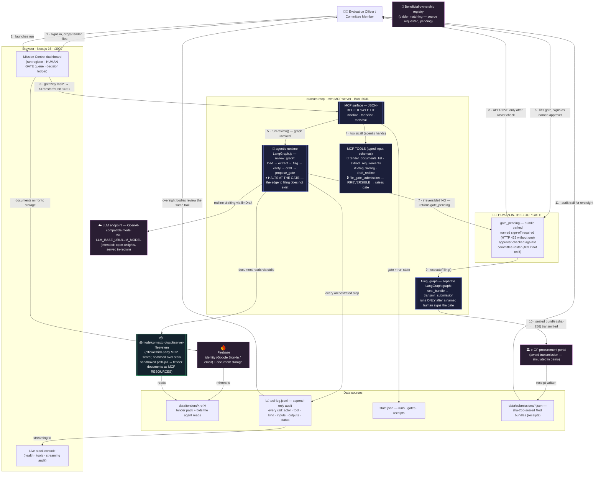

# Architecture Diagram

> **Upload an architecture diagram showing the relationship between:** Agents, LLMs/models, MCP client/server components, MCP tools/resources, External APIs, Data sources, Human-in-the-loop, Overall data flow.

---

## The diagram (Mermaid — renders on GitHub, GitLab, Notion and most form uploaders accept the exported PNG)



## Component legend — where each required piece sits

| Required component | In the diagram above | In the code |
| --- | --- | --- |
| **Agent** | `agentic runtime` (LangGraph.js `review_graph`, 6 nodes, halts at the gate) | `mini-services/quorum-mcp/engine.ts` → `runReview()` |
| **LLMs / models** | any OpenAI-compatible endpoint (`LLM_BASE_URL`/`LLM_MODEL`); intended: open-weights, in-region | `llmDraft()` in `engine.ts` (redlines), template fallback if unreachable |
| **MCP server (own)** | `quorum-mcp` :3031 — JSON-RPC 2.0 `initialize`/`tools/list`/`tools/call` | `POST /mcp` in `index.ts` |
| **MCP client/server (third-party)** | official `@modelcontextprotocol/server-filesystem`, spawned over stdio; tender docs surface as **MCP resources** | `initFsMcp()` in `engine.ts` |
| **MCP tools** | 5 registered tools: 2 READ, 3 state-changing (`flag_finding`, `draft_redline`, gated `file_gate_submission`) | `TOOLS` registry in `engine.ts` |
| **External APIs** | e-GP portal (award transmit), LLM endpoint, beneficial-ownership registry (requested), Firebase (auth + storage) | `executeFiling()` receipt → `egp-portal`; `src/instrumentation.ts` etc. |
| **Data sources** | tender pack dir, `tool-log.jsonl` audit, `state.json` (runs/gates), submission receipts | `mini-services/quorum-mcp/data/` |
| **Human-in-the-loop** | the gate: irreversible filing parked (`gate_pending`) until a *named* approver signs; refused 422 without a name, 403 if not on the committee roster | `decideGate()` in `index.ts` → `POST /api/gates/:id/decision` |
| **Overall data flow** | numbered steps 1→11: upload → run launch → tool calls → graph review → gate → named sign-off → seal & file → receipt → audit trail | the node edges above |

## Why the flow looks the way it does

- **Filing is not reachable from the agent.** `review_graph` ends at `propose_gate`; only the *separate* `filing_graph` transmits, and it is invoked exclusively from `decideGate()` after approval. No prompt, no tool misuse, and no graph path can file without a human.
- **Every hand is logged.** READ, WRITES and IRREVERSIBLE calls all append one line to `tool-log.jsonl` — actor, server, tool, kind, inputs, outputs, duration, status.
- **The gate is identity-checked twice.** First a named full-name is required (422 if absent), then the name is matched against the committee roster or the signed-in officer (403/503 otherwise). Oversight bodies read the same log the agent writes.

## ASCII fallback (for forms that don't render Mermaid)

```
Officer ──1──▶ Browser (Next.js :3000) ──3──▶ quorum-mcp :3031 (own MCP server, JSON-RPC 2.0)
   │                │  mirror docs                │  tools/call — 5 typed tools (2 READ · 3 WRITE/gated)
   │                ▼                             │
   │            Firebase (identity + storage)     ├─▶ agent runtime (LangGraph review_graph:
   │                                              │     load → extract → flag → verify → draft)
   │  6 · signs as named approver                 │        │ stdio
   ▼                                              │        ▼
HUMAN GATE ◀──7─ gate_pending (no graph edge ◀────┘    @modelcontextprotocol/server-filesystem
   │              to filing exists)                        │ reads
   │ 8 · APPROVE (roster-checked 403/503)                  ▼
   │                                              data/tenders/<ref>/  (tender pack + bids)
   ▼
filing_graph (separate graph) ──▶ seal sha-256 ──▶ e-GP portal ──▶ receipts data/submissions/*.json
                                          ▲
drafting ──▶ configured LLM endpoint    audit: every call → tool-log.jsonl (append-only)
```
